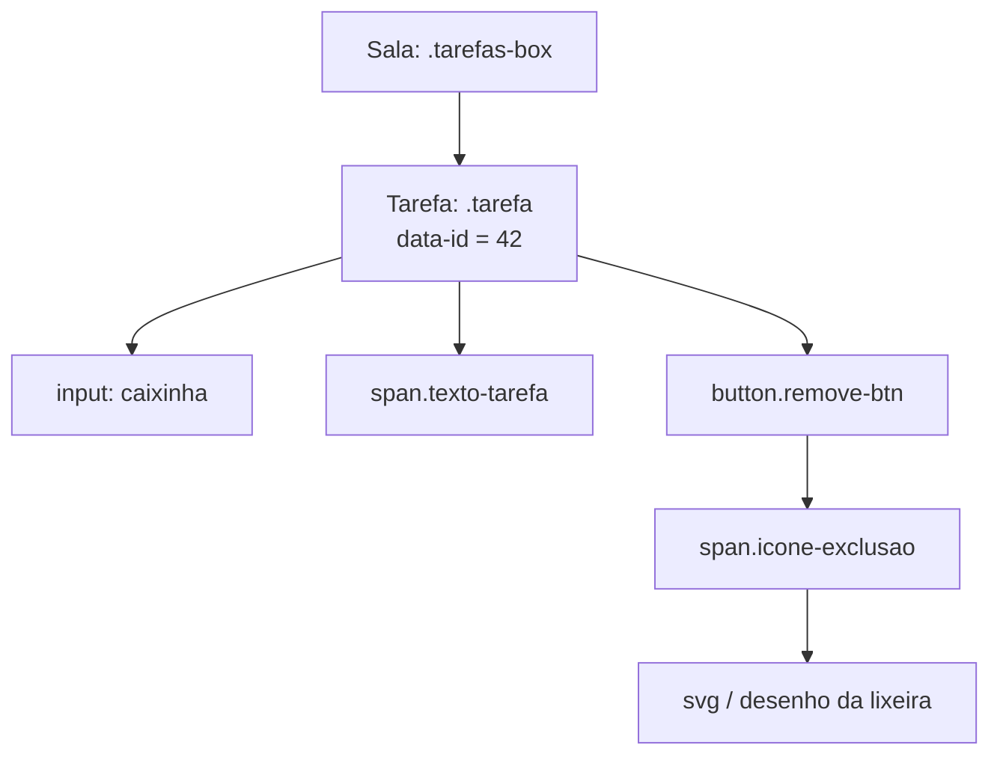
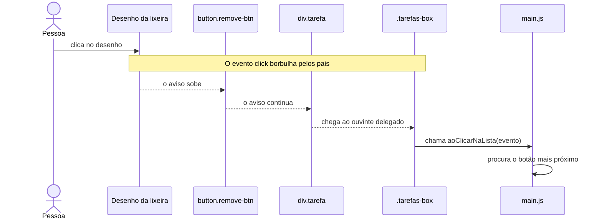
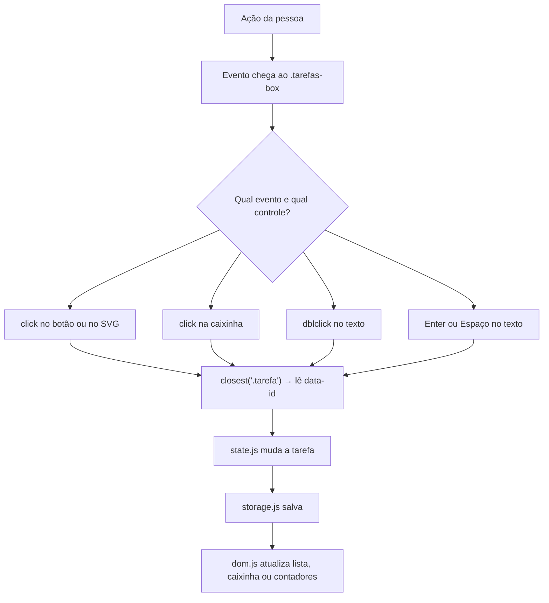

# A aventura da delegação de eventos

## Como um ouvinte cuida de uma lista inteira de tarefas

> **Este artigo é para quem está começando.** Vamos imaginar que a lista de
> tarefas é uma sala de aula e que cada clique é uma criança levantando a mão.
> No fim, você vai conseguir contar a aventura completa: do clique até a tarefa
> ser marcada, removida ou editada.

---

## 1. O que é um evento?

Um **evento** é um acontecimento que o navegador percebe. Por exemplo:

- alguém clicou em um botão;
- alguém apertou uma tecla;
- alguém enviou um formulário;
- alguém deu dois cliques em um texto.

É como quando a campainha toca: aconteceu alguma coisa, e o programa pode
decidir o que fazer.

Em JavaScript, podemos pedir para o navegador prestar atenção usando
`addEventListener`:

```js
botao.addEventListener('click', minhaFuncao);
```

Isso quer dizer: “Navegador, quando alguém clicar neste botão, chame
`minhaFuncao`”. A função que espera o evento é chamada de **ouvinte** ou
**listener**.

---

## 2. A sala de aula da nossa lista

Imagine que cada tarefa é uma criança sentada na sala. Cada criança tem três
coisas para usar: uma caixinha para marcar, um texto e um botão para apagar.
O botão de apagar ainda tem um desenho de lixeira dentro dele.

No HTML criado pelo JavaScript, a estrutura fica parecida com esta:

```text
.tarefas-box                 ← a sala (container que continua no lugar)
└── .tarefa[data-id="42"]    ← uma criança/tarefa
    ├── input[type=checkbox] ← caixinha de conclusão
    ├── .texto-tarefa        ← texto que pode ser editado
    └── button.remove-btn    ← botão para apagar
        └── .icone-exclusao  ← desenho dentro do botão
            └── svg
                └── path     ← pedacinho do desenho
```

O `.tarefas-box` é a **sala**. Os elementos `.tarefa` são os itens que ficam
dentro dela. A função `criarElementoTarefa()` em `js/dom.js` monta cada item.
Ela também coloca o ID verdadeiro da tarefa em `data-id`, como um crachá:

```js
div.dataset.id = String(tarefa.id);
```

Esse crachá é importante: a aplicação identifica uma tarefa pelo ID, não pela
posição dela na fila. Se a tarefa da frente for apagada, os crachás das outras
continuam iguais.



---

## 3. Dois jeitos de chamar a professora

### Jeito A: cada criança tem seu próprio sininho

Poderíamos colocar um ouvinte em cada caixinha, texto e botão. Com 3 tarefas,
teríamos vários ouvintes. Com 100 tarefas, teríamos centenas de lugares para
instalar e cuidar.

Além de dar mais trabalho, existe uma pegadinha: tarefas novas são criadas
depois que a página começa. Cada tarefa nova precisaria receber seus próprios
ouvintes.

### Jeito B: uma professora fica na porta da sala

Em vez disso, colocamos ouvintes no container `.tarefas-box`. Quando uma criança
faz alguma coisa, o navegador leva o aviso até a sala. A sala descobre qual
criança começou a conversa e o que ela fez.

Esse jeito se chama **delegação de eventos**: um elemento maior escuta eventos
que começaram em elementos menores.

No projeto, não é literalmente um único ouvinte para tudo. A lista registra
**um ouvinte para cada tipo de evento delegado**: `click`, `dblclick` e
`keydown`. O importante é que eles ficam no container, e não em cada tarefa.

### Por que esse jeito combina com este projeto?

Porque a nossa lista é **viva**: a pessoa pode criar e apagar tarefas, e a
interface é redesenhada em alguns desses momentos. A função `renderizarLista()`
em `js/dom.js` usa `replaceChildren()` para trocar os itens que estão dentro de
`.tarefas-box`. Se cada botão e cada caixinha tivesse seu próprio ouvinte, ao
trocar os itens também trocaríamos esses elementos — e seria preciso instalar
todos os ouvintes de novo, sem esquecer nenhum.

Com a delegação, os itens podem sair e entrar, mas a “sala” `.tarefas-box`
continua no lugar com seus ouvintes. A tarefa nova já chega podendo ser marcada,
editada e removida. O `data-id` funciona como crachá para `main.js` descobrir
qual tarefa recebeu a ação.

Isso também deixa o projeto mais fácil de aprender: três ouvintes ficam juntos
em `configurarDelegacaoDeEventos()`, e três funções explicam as ações da lista
(`aoClicarNaLista()`, `aoDuploCliqueNaLista()` e `aoPressionarTeclaNaLista()`).
Em vez de decorar cada cadeira com um sininho, aprendemos uma regra importante
do navegador: os eventos sobem até seus pais.

> **A escolha não é porque delegação sempre deixa tudo mais rápido.** Nesta
> lista pequena, a diferença de velocidade provavelmente é quase invisível.
> Ela foi indicada principalmente porque os itens são dinâmicos e são trocados
> durante a renderização; delegar evita religar ouvintes em cada item e mantém
> o código organizado. Para um controle único e permanente, um ouvinte direto
> também pode ser uma ótima escolha.

O formulário de criar tarefa tem um ouvinte separado para `submit`, porque ele
fica fora da lista. Assim, clicar em **Criar** ou apertar Enter no campo é
tratado por `aoSubmeterFormulario()` no formulário, não pela delegação da sala
de tarefas.

---

## 4. Como o aviso chega até a sala?

O navegador tem um caminho para muitos eventos, como `click` e `keydown`:

1. O evento começa no elemento que recebeu a ação.
2. Depois, ele sobe pelos elementos que estão em volta.
3. Quando chega ao `.tarefas-box`, o ouvinte da lista pode agir.

Essa subida é chamada de **propagação** ou **bubbling** — pense em bolhas que
sobem na água. O evento começa lá embaixo e sobe até o pai.

Se a pessoa clicar exatamente no desenho SVG da lixeira, o evento começa no
desenho, passa pelo botão e chega à lista:



### `target` e `currentTarget`: quem começou e quem está ouvindo?

O objeto `evento` conta detalhes sobre o acontecimento:

- **`evento.target`**: o elemento onde a ação começou. No exemplo, pode ser o
  `svg` ou até um `path` dentro dele.
- **`evento.currentTarget`**: o elemento cujo ouvinte está sendo executado. Na
  delegação desta lista, é o `.tarefas-box`.

É como uma carta: `target` diz de quem veio a mensagem; `currentTarget` diz qual
professora está lendo a carta agora.

---

## 5. A professora procura o botão certo com `closest()`

O clique pode chegar à lista vindo de um desenho, de um `<span>` ou do próprio
botão. Por isso, não é seguro perguntar apenas “o alvo é o botão?”. Às vezes, o
alvo é um filho que mora dentro dele.

`closest()` começa no elemento indicado e vai subindo pela árvore do HTML até
encontrar o primeiro elemento que combina com um seletor:

```js
const botaoRemover = evento.target.closest(SELETORES.botaoRemover);
```

No desenho da lixeira, a busca faz assim:

```text
path → svg → span.icone-exclusao → button.remove-btn ✅ achou!
```

Os seletores não ficam espalhados pelo programa: `SELETORES.botaoRemover`,
`SELETORES.checkboxTarefa` e `SELETORES.textoTarefa` vêm de
`js/constants.js`. Assim, o nome da classe tem uma fonte central.

Depois de encontrar um controle, a aplicação sobe mais um pouco para achar a
tarefa que o contém:

```js
const elementoTarefa = elemento.closest(SELETORES.tarefa);
const id = elementoTarefa ? Number(elementoTarefa.dataset.id) : null;
```

Na função real `obterIdDaTarefa()` de `js/main.js`, isso transforma o crachá
`data-id` em número. Se não houver tarefa, a função devolve `null` e a ação
para com segurança.

---

## 6. A jornada de cada ação

### A. Apagar uma tarefa

O ouvinte de clique verifica primeiro se o alvo — ou algum pai dele — pertence
ao botão de apagar:

```js
function aoClicarNaLista(evento) {
  const botaoRemover = evento.target.closest(SELETORES.botaoRemover);
  if (botaoRemover) {
    removerDaInterface(botaoRemover);
    return;
  }

  const checkbox = evento.target.closest(SELETORES.checkboxTarefa);
  if (checkbox) {
    alternarConclusao(checkbox);
  }
}
```

Se encontrou o botão, `removerDaInterface()` descobre o ID, manda
`state.js` remover aquela tarefa e depois salva e redesenha a lista. O `return`
evita que o mesmo clique continue sendo analisado como se fosse um clique na
caixinha.

### B. Marcar como concluída

Se não era o botão de apagar, a função procura uma caixinha de seleção. Quando
a encontra, `alternarConclusao()` descobre o ID e pede ao estado da aplicação
para inverter `completa` de verdadeiro para falso ou de falso para verdadeiro.

Depois, a tarefa é salva e os contadores são atualizados. A interface muda
somente a caixinha clicada: ela não precisa construir todas as tarefas de novo.
Isso preserva o elemento que a pessoa está usando.

### C. Editar o texto

Para editar com o mouse, outro ouvinte delegado espera `dblclick` (duplo clique)
e procura o texto mais próximo com `closest(SELETORES.textoTarefa)`.

Para editar com o teclado, o ouvinte delegado de `keydown` só aceita `Enter` ou
`Espaço`. O texto da tarefa tem `tabIndex = 0`, então pode receber foco pelo
teclado. O código chama `preventDefault()` para impedir que o Espaço role a
página enquanto abre a edição.

Ao abrir a edição, `dom.js` cria um campo de texto. Esse campo tem seus próprios
ouvintes locais para `keydown` e `blur`: Enter salva, Escape cancela e perder o
foco salva depois de um pequeno atraso. Isso não contradiz a delegação: a lista
delegou os gestos das tarefas; o campo temporário tem comportamentos especiais
que pertencem somente a ele.



---

## 7. Por que tarefas novas já funcionam?

Quando uma tarefa é criada, `renderizarLista()` em `js/dom.js` troca os filhos
do container usando `replaceChildren()`. Ela troca as tarefas que estão **dentro**
da sala, mas não troca a própria sala `.tarefas-box`.

O ouvinte continua na sala, esperando. Por isso, uma tarefa criada agora já
funciona sem receber um novo `addEventListener`.

```text
Antes:  sala [ouvinte] → tarefa A, tarefa B
Depois: sala [mesmo ouvinte] → tarefa A, tarefa B, tarefa C
```

É como uma professora que continua na mesma sala enquanto os alunos entram e
saem. Não precisamos contratar outra professora para cada aluno novo.

Na inicialização da aplicação, `inicializarAplicacao()` chama
`configurarDelegacaoDeEventos()`. Essa função pega o container e instala os
três ouvintes:

```js
container.addEventListener('click', aoClicarNaLista);
container.addEventListener('dblclick', aoDuploCliqueNaLista);
container.addEventListener('keydown', aoPressionarTeclaNaLista);
```

---

## 8. Um cuidado: nem todo evento borbulha

`click`, `dblclick` e `keydown` sobem até os pais e são usados pela delegação
neste projeto. Mas **nem todos os eventos funcionam assim**. Por exemplo,
`blur` não borbulha da mesma maneira; por isso, a edição escuta `blur`
diretamente no campo que perde o foco.

Antes de delegar um evento, descubra se ele borbulha e se faz sentido escutá-lo
no pai. Também precisamos escolher um container que continue existindo. Se o
container inteiro for removido e criado de novo, o ouvinte antigo vai embora
com ele.

---

## 9. Como sabemos que funciona?

Os testes de `tests/main.test.js` verificam a orquestração no DOM. Por exemplo,
eles clicam na caixinha para testar a conclusão e despacham eventos de teclado
para testar Enter e Espaço na edição.

O teste E2E em `tests/e2e/aplicacao.spec.ts` chamado
**“remove a tarefa quando o clique atinge o SVG interno”** é especialmente
legal: ele clica no desenho dentro do botão e confirma que a tarefa some. Isso
prova que a busca com `closest()` encontra o botão mesmo quando o clique não
começa no próprio botão.

Outro teste cria duas tarefas, marca só a segunda e confere que a primeira
continua desmarcada. Assim verificamos que o `data-id` levou a ação para a
tarefa certa.

---

## 10. Experiência de detetive: acompanhe um clique

Abra a aplicação no navegador e siga estes passos:

1. Abra as ferramentas do desenvolvedor (F12).
2. Na aba **Elements/Inspector**, encontre `.tarefas-box`.
3. Veja que cada tarefa tem `data-id`, uma caixinha, um texto e um botão.
4. No código de `js/main.js`, coloque um breakpoint dentro de
   `aoClicarNaLista()`.
5. Clique no desenho da lixeira.
6. Quando o programa pausar, confira `evento.target` e observe que ele pode ser
   o SVG ou um elemento dentro dele.
7. Avance linha por linha até `closest()` encontrar `button.remove-btn` e até
   `obterIdDaTarefa()` encontrar `.tarefa`.

Você acabou de seguir o bilhete desde quem o escreveu até a professora que sabe
o que fazer com ele!

---

## 11. Mini-desafio

**Pergunta:** se uma nova tarefa for adicionada depois que a página abriu, por
que o botão dela já funciona sem um novo `addEventListener`?

<details>
  <summary>Ver resposta</summary>

Porque o ouvinte está no container `.tarefas-box`, que continua no DOM. O clique
no botão novo borbulha até esse container, e `closest()` encontra o botão e sua
tarefa.

</details>

**Bônus:** se clicar no `<path>` da lixeira, qual elemento será `evento.target`?

<details>
  <summary>Ver resposta</summary>

O `<path>` (ou outro pedaço do SVG atingido pelo clique). Por isso o código não
depende de `target` já ser o botão: ele usa `closest()` para subir até o botão
mais próximo.

</details>

---

## 12. Resumo de bolso

Guarde estas quatro ideias:

1. **Evento:** algo aconteceu, como um clique ou uma tecla.
2. **Bubbling:** muitos eventos sobem do elemento clicado para seus pais.
3. **Delegação:** um pai escuta eventos de vários filhos, inclusive filhos
   criados depois.
4. **`closest()`:** ajuda a descobrir qual controle e qual tarefa estão acima
   do ponto clicado.

Neste projeto, `.tarefas-box` é a sala, `main.js` é a professora, `data-id` é o
crachá e `state.js` guarda a verdade sobre cada tarefa. Assim a lista fica
organizada, os controles recém-criados funcionam e a mesma regra atende mouse e
teclado. Missão cumprida! 🎒
